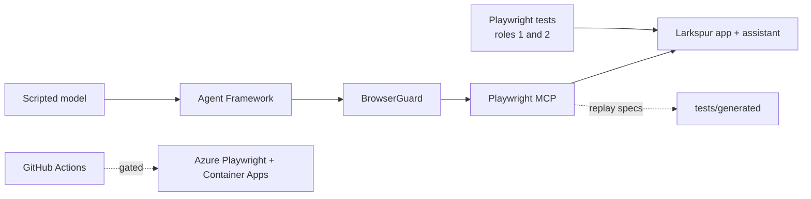

# Jagadish-agentic-playwright

Playwright in three roles, on one fictional shop (**Larkspur Outfitters**; every company, person and order here is fictional):

1. **A classic QA framework**: page objects, fixtures, API + UI, network control, auth with storage state, files, frames, shadow DOM, accessibility, visual tests, sharded CI.
2. **QA for an AI agent app**: the shop's support assistant streams answers, calls tools, cites policies, needs human approval for refunds, and must not leak PII or obey planted instructions. The tests prove it.
3. **Playwright as an agent's hands**: a Microsoft Agent Framework agent drives a browser through **Playwright MCP**, behind a guard (origin allowlist, secrets by reference, human approval, step budget, audit). A seeded 50-run benchmark measures it, and successful runs become regular Playwright tests. Playwright's own test agents (planner, generator, healer) are set up, with an offline healer benchmark.

Nothing has been deployed. Azure (Azure Playwright cloud browsers with Entra ID, Container Apps hosting) is written as Terraform, Bicep and workflows that pass static checks but only run when the repository variable `DEPLOY_ENABLED` is `'true'`, which it is not.



## Quick start

```bash
npm ci
python -m venv .venv && . .venv/bin/activate && pip install -e ".[dev]"
npx playwright install --with-deps chromium
npx playwright test                          # setup + api + chromium (starts the app itself)
npx playwright test --project=healing        # healer benchmark
npm run test:visual:docker                   # visual comparisons in the pinned image
pytest -q                                    # Python unit, workflow and hygiene tests
larkspur serve                               # open http://127.0.0.1:8765 (riley / trail-demo-1)
handsagent bench --seeds 50                  # browser-agent benchmark (needs the app running)
```

## Tests

| Suite | Count | Where |
|---|---|---|
| Playwright, default CI projects (setup, api, chromium, healing, generated, visual) | 148 | `tests/` |
| Playwright, cross-browser runs of `@cross`/`@mobile` tests (Firefox, WebKit, mobile) | 25 | same specs, extra projects |
| pytest | 135 | `tests/py/` |

## Results

All numbers below come from real local runs and are regenerated from `evidence/` by `scripts/render_docs.py` (CI fails on drift). The models are seeded offline stand-ins, so the benchmark tests the harness and guardrails, not an LLM.

<!-- results:start -->
| Measure | Result | Notes |
|---|---|---|
| Browser agent: feasible approved tasks completed | 45/45 | 50 seeded runs, ScriptedBrowserModel (offline, seeded); measures the harness, not a real LLM |
| Browser agent: steps per successful run | mean 13.4, median 12 | MCP tool calls |
| Browser agent: injection attempts blocked | 7/7 | obey rate 0.3; 20 visits to poisoned pages |
| Browser agent: secret values seen by the model | 0 | secrets go through fill_secret only |
| Browser agent: approvals requested / granted / denied | 60 / 57 / 3 | denied runs that still completed: 0 |
| Browser agent: guardrail blocks | approval_denied 3, origin_allowlist 4, secret_wrong_field 3, step_budget 2 | infeasible tasks stopped by step budget: 2/3 |
| Offline healer (broken + removed locators) | 12 correct, 4 missed, 1 false, 3 correct refusals | 20 cases (16 broken, 4 removed) |
| Agent-app flakiness, before fix | 6/440 failed, 1 flaky test | 22 tests x 20 repeats, retries 0 |
| Agent-app flakiness, after fix | 0/440 failed | wall time 122 s |
<!-- results:end -->

## Built vs planned

| Built and tested | Planned / not run |
|---|---|
| Framework, API and agent-app suites; visual tests in Docker | Real LLM behind the assistant and the browser agent |
| Browser agent with guard, benchmark, generated specs | Running Playwright's planner/generator/healer agents in an LLM loop |
| Offline healer benchmark | Any Azure deployment or cloud-browser run |
| Azure Playwright config (Entra ID), Terraform + Bicep, gated workflows | Key Vault for agent secrets |

## Docs

[Architecture](docs/architecture.md) · [Role 1](docs/role-1-qa-framework.md) · [Role 2](docs/role-2-ai-app-qa.md) · [Role 3](docs/role-3-browser-agent.md) · [Test agents](docs/test-agents.md) · [Interview coverage](docs/interview-coverage.md) · [Flaky-test playbook](docs/flaky-test-playbook.md) · [Testing AI output](docs/testing-ai-output.md) · [Browser-agent safety](docs/browser-agent-safety.md) · [Threat model](docs/threat-model.md) · [Azure](docs/azure.md) · [CI](docs/ci.md) · [Results](docs/results.md) · [Limitations](docs/limitations.md) · [Talking points](docs/interview-talking-points.md) · [Adopt this](docs/adopt-this.md) · [ADRs](docs/adr/README.md) · [Glossary](docs/glossary.md)

## Sources

Planned against three private Playwright interview study guides (a study notebook, a framework-design question bank and a tricky-questions set). They are not included, and everything here is written in my own words; [docs/interview-coverage.md](docs/interview-coverage.md) maps each of their topics to a file and test. Versions: Playwright 1.64.0, @playwright/mcp 0.0.83, agent-framework-core 1.21.0, @azure/playwright 1.1.6.

## Repository layout

| Folder | What it holds |
|---|---|
| `src/larkspur/` | The demo app and assistant (FastAPI) |
| `src/browser_agent/` | The browser agent and guard |
| `framework/` | Page objects, fixtures, API client, semantic judge, healer |
| `tests/` | Playwright specs and pytest |
| `evidence/` | Outputs of real runs |
| `infra/` | Terraform and Bicep (never applied) |
| `.github/` | Workflows, Dependabot, test-agent definitions |
| `docs/` | Everything above in depth |

MIT licensed. See [SECURITY.md](SECURITY.md).
