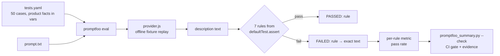

# Business-rule evals for AI-written product copy (promptfoo)

**Recruiter summary.** AI can write product descriptions that read well but break a brand or legal rule, for example a wallet that is "the best you'll ever own". This module checks AI copy for the fictional store Larkspur Outfitters with [promptfoo](https://www.promptfoo.dev/). There are 7 business rules, each one in its own file. When a rule fails, the report gives the rule name and the exact text that broke it. On 50 synthetic descriptions, every case failed exactly the rules it was written to break (50/50). All 34 failures named their rule and quoted the text. The same rules written as bare booleans gave 0 of 34 failures with any evidence. Everything runs offline, with no API key and no cost.

Code: [`evals/promptfoo/`](../evals/promptfoo/README.md). Numbers: [`evidence/promptfoo-evals.json`](../evidence/promptfoo-evals.json) (also in [results.md](results.md)).

## Who it is for

- QA and SDET engineers who test features that generate text.
- Content, brand or legal teams who want their written rules turned into checks that run in CI.
- Interviewers: this shows how I make an eval failure useful to the person who has to fix it.

## The bare-boolean trap

A first eval often checks words, like "the copy contains *leather*". That checks vocabulary, not policy. Copy can say "leather" and still promise a grade of leather the product does not have.

The next step people usually take is a JavaScript assertion that returns `true` or `false`. It works, but a red row tells you almost nothing. We ran the same 7 rules both ways on the same 50 cases (`promptfooconfig.bare.yaml` is the boolean version):

| | Bare booleans | Named rules |
|---|---|---|
| Failed checks | 34 | 34 |
| Failure reasons that quote the text that broke the rule | **0** | **34** |
| Reasons that say only "Custom function returned false" | 34 | 0 |
| Per-rule metrics in the results | 0 | 7 |

A real bare reason from our run: `Custom function returned false` followed by the file path `file://assertions/bare/no_intro_cliche.js`. To be fair, promptfoo 0.125.1 adds the file path, so if you keep one rule per file you can guess the rule from the path. If you write the check inline in the YAML, you do not even get that. Either way, you still have to open the copy, read the brand guide and find the broken sentence yourself. With 50 cases and 7 rules that is 350 checks to hunt through.

## The fix: named rules



1. **One file per rule.** Each rule is `assertions/<rule>.js`, loaded with `value: file://assertions/<rule>.js`.
2. **Declared once.** All 7 rules sit under `defaultTest.assert` in `promptfooconfig.yaml`, so all 50 cases inherit them. No test case repeats them.
3. **Facts come from the test case.** The rule receives `(output, context)` and reads `context.vars`: product name, catalog materials, care note, approved claims, word limits. No product name is written in rule code, so one file works for every product.
4. **A useful return value.** Each rule returns `{ pass, score, reason }`. On failure the reason is `FAILED: <rule> → <evidence>`, and the evidence is the exact text from the copy.
5. **One metric per rule.** Each assertion has `metric: <rule>`, so promptfoo reports a score per rule. You get 7 numbers to watch over time instead of one pass rate.

Config excerpt (real file, `evals/promptfoo/promptfooconfig.yaml`):

```yaml
defaultTest:
  vars:
    min_words: 35
    max_words: 110
  assert:
    - type: javascript
      value: file://assertions/no_intro_cliche.js
      metric: no_intro_cliche
    - type: javascript
      value: file://assertions/no_unapproved_superlatives.js
      metric: no_unapproved_superlatives
    # ... 5 more, one per rule
tests: file://tests.yaml
```

Rule excerpt (real file, `assertions/required_care_or_disclaimer.js`):

```js
function requiredCareOrDisclaimer(output, context) {
  const required = varsOf(context).care_note;
  if (!required) return failed(RULE, 'test case has no care_note variable');
  const want = norm(required).replace(/\.$/, '');
  const t = text(output);
  if (norm(t).includes(want)) return passed(RULE);
  const sentences = t.trim().split(/(?<=[.!?])\s+/);
  return failed(RULE, `missing ${quote(required)}; last sentence was ${quote(sentences[sentences.length - 1], 70)}`);
}
```

## The 7 rules

| Rule (metric) | What it enforces | Reads from vars |
|---|---|---|
| `no_intro_cliche` | No stock openers ("Introducing…", "Meet the…", "Look no further") and no "game-changer" | none |
| `no_unapproved_superlatives` | No "best … you'll ever own", "#1", "unbeatable", "100% waterproof", "lifetime guarantee", "the warmest" and similar, unless legal approved that exact claim for this product | `approved_claims` |
| `material_claim_matches_catalog` | Every material named must be in the catalog for this product. A specific grade must match exactly (full-grain is not top-grain). Generic words like "leather" are fine if a catalog material contains them, but vegan leather does not count as leather. | `materials` |
| `required_care_or_disclaimer` | The care instruction or safety note appears word for word (case and spacing ignored) | `care_note` |
| `length_within_limits` | Word count fits the page slot | `min_words`, `max_words` (defaults in `defaultTest.vars`) |
| `brand_voice` | Calm voice: no exclamation marks, no shouting in capitals (approved acronyms such as DWR, PFAS and BPA are allowed), no sales pressure ("Hurry", "Order yours today") | `allowed_caps` |
| `names_the_product` | The exact catalog product name appears, with the same capital letters | `product_name` |

## Real eval output

Run on this box with promptfoo 0.125.1 and Node 22, and again with networking switched off (`unshare -rn npm run eval`). The results were the same, which shows nothing calls out. The data is 50 synthetic descriptions: 10 fictional products with 5 descriptions each. 29 are clean, and 21 were written to break 1 to 3 rules. This is a **regression check of the rules**, not a measure of any model.

| Rule | Passed | Pass rate |
|---|---|---|
| no_intro_cliche | 45/50 | 90% |
| no_unapproved_superlatives | 43/50 | 86% |
| material_claim_matches_catalog | 41/50 | 82% |
| required_care_or_disclaimer | 47/50 | 94% |
| length_within_limits | 47/50 | 94% |
| brand_voice | 45/50 | 90% |
| names_the_product | 48/50 | 96% |

The pass rates are low by design, because we planted the failures. What matters is that each case failed exactly its planted rules (50/50) and no rule fired on a clean case.

Real failure reasons from `out/results.json`:

```text
c34  FAILED: no_intro_cliche → "Introducing the Harbor Bifold Wallet"
c34  FAILED: no_unapproved_superlatives → "best wallet you'll ever own"
c34  FAILED: material_claim_matches_catalog → "Full-grain leather" not in catalog materials [top-grain leather, cotton]
c19  FAILED: brand_voice → "TRAIL"; "READY"
c25  FAILED: length_within_limits → 125 words > max 110; overflow starts at "have a sternum strap with a small whistle"
c29  FAILED: required_care_or_disclaimer → missing "Keep flames and heat sources away from the tent fabric."; last sentence was "Cook in the vestibule on rainy nights and enjoy the view from the doo…"
```

Console summary from `python scripts/promptfoo_summary.py --check`:

```text
no_intro_cliche                  45/50 pass (90%)
no_unapproved_superlatives       43/50 pass (86%)
material_claim_matches_catalog   41/50 pass (82%)
required_care_or_disclaimer      47/50 pass (94%)
length_within_limits             47/50 pass (94%)
brand_voice                      45/50 pass (90%)
names_the_product                48/50 pass (96%)
cases 29/50 clean; 50/50 failed exactly the rules they were written to break
```

## How to run

Offline (Node 22.22 or newer, which promptfoo 0.125.1 needs):

```bash
cd evals/promptfoo
npm ci
npm test                       # node --test: unit tests for every rule + config/fixture checks
npm run eval                   # both configs -> out/results.json, out/results-bare.json
cd ../.. && python scripts/promptfoo_summary.py --check   # the CI gate
npx --prefix evals/promptfoo promptfoo view               # optional local web viewer
```

`npm run eval` turns off telemetry, sharing and update checks, and keeps promptfoo's state in `out/.promptfoo`. Failed cases do not change the exit code, because some fixtures fail on purpose. The summary `--check` is the gate instead: it fails if any case breaks a different set of rules than planned, if a reason is not in `FAILED: <rule> → <evidence>` form, or if the committed evidence drifts. After you change a fixture or rule on purpose, run `python scripts/promptfoo_summary.py` and then `python scripts/render_docs.py`.

With a real model (planned, not run here): replace the `providers` entry with a model provider, for example an Azure OpenAI deployment, and remove `metadata.expect_fail` from the cases. Run each case several times with `--repeat`, and watch each rule's pass rate over time instead of expecting exact failures.

## How CI runs it

The `promptfoo` job in [`.github/workflows/ci.yml`](../.github/workflows/ci.yml) does `npm ci`, `npm test`, `npm run eval` and `promptfoo_summary.py --check`, and uploads the JSON results as an artifact. It uses no secrets. The pytest suite also checks the wiring and the evidence (`tests/py/test_promptfoo_evals.py`). When Node 22 is installed, it runs the live eval as well, with every `*_API_KEY` variable removed. `scripts/gate.py` also blocks a release unless every case failed exactly its planted rules.

## Guardrails

- No network, no keys: the provider replays `fixtures/descriptions.json`. We checked this with networking switched off.
- Rule code reads only `output` and `context.vars`. The planned failures are stored in `metadata`, which the rules never read, so a rule cannot pass by looking at the answer key.
- Negative controls: 29 clean cases must pass every rule, so a rule that always fails is caught. Each rule also has unit tests in both directions (96 `node --test` tests).
- Evidence quotes are cut at 90 characters, and they only ever quote the generated copy, never other data.

## Limitations and known gaps

- **Synthetic, self-written data.** We wrote both the 50 descriptions and the rules, so 50/50 shows the rules do what we meant. It does not show they catch what a real model writes. Treat it as a regression check.
- **Pattern rules.** The superlative, cliché and pressure lists are regexes. They will miss new wording such as "the last wallet you will ever need to buy", and they can flag fine phrases. A real setup would add an LLM judge (`llm-rubric`) for intent, keep these rules for exact policy, and calibrate the judge against human labels.
- **Material vocabulary is closed.** A material that is not in the rule's list (for example a new fabric name) is not checked at all.
- **Binary scores.** Each rule scores 0 or 1. Length could be graded, but we kept it binary to make the rules easier to explain.
- **Version-specific output.** The bare-boolean reason text is what promptfoo 0.125.1 produced. Other versions may word it differently.
- **Not run against a model.** No model, Azure or otherwise, was called for these numbers.

## Interview points

- A check that only says *false* sends someone to dig through the copy. A check that says *FAILED: material_claim_matches_catalog → "Full-grain leather" not in catalog materials [top-grain leather, cotton]* can be fixed right away.
- Rules declared once under `defaultTest` and fed by `vars` keep them like code: one place to change, every case covered.
- One metric per rule turns one blurry pass rate into seven numbers, so you can see which policy got worse after a prompt change.
- Planted failures plus clean cases test the tester. Without negative controls, a broken rule looks perfect.
- YAML lists in `vars` make promptfoo expand a case into one case per item (our first run went from 50 to 85 cases). We store list-like facts as comma-separated strings.

## Related

[Testing AI output](testing-ai-output.md) covers the layered approach for the support assistant (structure, forbidden content, meaning, rubrics), and this module adds named-rule copy evals beside it. Decision record: [ADR 0007](adr/0007-named-rule-evals.md).

Idea credit: a paid bootcamp lesson on promptfoo assertions (not included; this page and the code are my own words and design).
