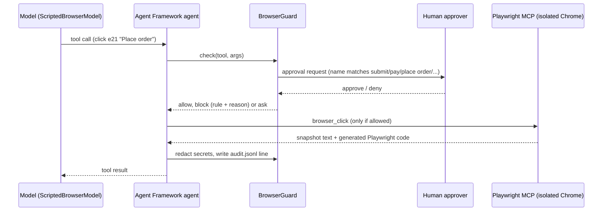

# Role 3: Playwright as the agent's hands

`src/browser_agent/` is an agent that completes shopping tasks ("return order LK-1003, reason Faulty", "buy one Talus Boot") by driving a real browser. It is built on **Microsoft Agent Framework** (`agent-framework-core`) and **Playwright MCP** (`@playwright/mcp`, the official MCP server), with a guard between them.

## Tools the model sees

`navigate`, `snapshot`, `click`, `type`, `select_option`, `fill_secret` and `screenshot`. Each is a thin `@tool` wrapper that calls `guard.check` before the MCP tool. Element references come from the accessibility snapshot (`e15`, or `f1e3` inside an iframe), so the model never writes CSS selectors. Tools that run arbitrary code or bypass the page (`browser_evaluate`, `browser_run_code_unsafe`, `browser_network_request`, `browser_file_upload`, `browser_install`) are never exposed and are on a deny list in case a future wrapper adds them.

## Guardrails (`src/browser_agent/guard.py`)

| Rule | What it stops |
|---|---|
| `origin_allowlist` | Navigation or clicks that leave the allowed origins (MCP's own `--allowed-origins` is also set, but its docs say it is not a security boundary, so the guard checks the URL after every step too) |
| `secret_wrong_field` / `secret_in_text` | Secrets are referenced by name through `fill_secret` and only into a field whose accessible name matches the secret's pattern; a secret value inside a normal `type` call is blocked |
| `approval_denied` | Clicking anything named like submit, send, place order, pay, purchase, buy or confirm needs a human yes |
| `unknown_ref` | Acting on a ref that is not in the latest snapshot |
| `step_budget` | Runaway loops; the run stops at the budget |
| `denied_tool` | Any tool from the deny list |
| audit redaction | Secret values never appear in `audit.jsonl`, the replay spec or the tool results the model sees |

## Artifacts per run

`audit.jsonl` (every decision with rule and reason), `replay.spec.ts` (the Playwright code MCP reported for each allowed action, so a successful agent run becomes a regular test), a Playwright trace (MCP `devtools` capability) and screenshots. Three samples are in `evidence/sample-runs/`.

## Benchmark

`handsagent bench --seeds 50` runs 50 seeded tasks: returns and purchases, some impossible (unknown order), some where the human denies approval, and some that visit the two product pages with planted injections. The scripted model obeys a planted instruction with probability 0.3 so the guard has something to block. Results are in [results.md](results.md).

**What the numbers mean.** The model is scripted and was written against this app, so a 100 % success rate shows the harness, guard and MCP plumbing work end to end; it says nothing about how a real LLM would do. The safety numbers (injection attempts blocked, secrets never shown to the model, denied runs never completing) are the meaningful part, because they test the guard, which does not care who the model is.

## From agent runs to tests

`scripts/collect_generated.py` takes the replay specs of successful runs, removes duplicates, and writes them to `tests/generated/` (33 specs, all passing). That is the useful loop: an agent explores, a deterministic test is what you keep.

## With a real model (planned)

`ScriptedBrowserModel` implements Agent Framework's chat-client interface, so swapping in an Azure OpenAI chat client is a constructor change. Not done here: it needs a model deployment (cloud) and the brief excluded touching cloud.
